# Ablaufdiagramme — KNXFANDRV / KwlControl

Stand: 2026-09-27, nach dem Review. Die Diagramme zeigen, was der Code **tut**,
nicht was der Plan vorsieht. Jede Box nennt die Funktion, in der es passiert.
Weicht ein Diagramm vom Code ab, gilt der Code, und das Diagramm wird nachgezogen.

Darstellung: Mermaid. GitHub zeigt es direkt an. In VS Code braucht die
Markdown-Vorschau die Erweiterung *Markdown Preview Mermaid Support*.

| Nr. | Diagramm | Frage, die es beantwortet |
|---|---|---|
| 1 | [Schichten](#1-schichten) | Wo entsteht was, und wer liest wen? |
| 2 | [Lebenszyklus des Geräts](#2-lebenszyklus-des-geräts) | Welche Spannung liegt in welchem Zustand an? |
| 3 | [Start](#3-start--kwlfanmodulesetup) | In welcher Reihenfolge wird initialisiert? |
| 4 | [Hauptschleife des Lüftermoduls](#4-hauptschleife--kwlfanmoduleloop) | Wann wird gefahren, wann gehalten? |
| 5 | [Raumschleife](#5-raumschleife--kwlroomloop) | Wie entsteht der Stufenwunsch eines Raums? |
| 6 | [Vorfahrt](#6-vorfahrt--stagearbiterupdate) | Welcher Rang gewinnt? |
| 7 | [Verbund je Takt-Platz](#7-verbund-je-takt-platz--kwlfanmoduledrivegroup) | Wie wird aus Räumen eine Stufe je Lüfter? |
| 8 | [Takt und Totzeit](#8-takt-und-totzeit--kwlgroupupdate) | Wann wechselt die Richtung? |
| 9 | [Abluftanforderung](#9-abluftanforderung--kwlroomrunexhaust) | Vorlauf, Nachlauf, Intermittierend |
| 10 | [Vom Stufenwunsch zum Bus](#10-vom-stufenwunsch-zum-bus--kwlfandrive) | Wie wird aus Stufe und Richtung ein DAC-Code? |
| 11 | [Master und Slave](#11-master-und-slave) | Was läuft über den Bus zwischen zwei Geräten? |
| 12 | [Fehlercode und LED](#12-fehlercode-und-led) | Was wird wo gemeldet? |

---

## 1. Schichten

Drei Ebenen, getrennt nach Zuständigkeit (CLAUDE.md, „Drei Ebenen, nicht eine“).
Das Lüftermodul liest die Räume **in-process**, nie über den Bus.

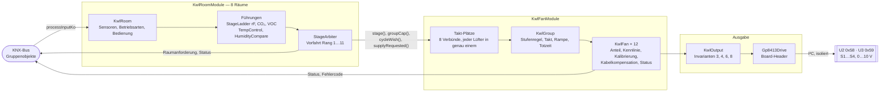

---

## 2. Lebenszyklus des Geräts

Der RP2040 hängt am **KNX-Bus**, die DACs hängen an den **12 V**. Beides fällt
getrennt aus. Die DACs halten jeden Wert, solange sie Strom haben, und starten
ohne gespeicherten Wert mit **0 V = Volllast** (Invariante 7, Befund B1).

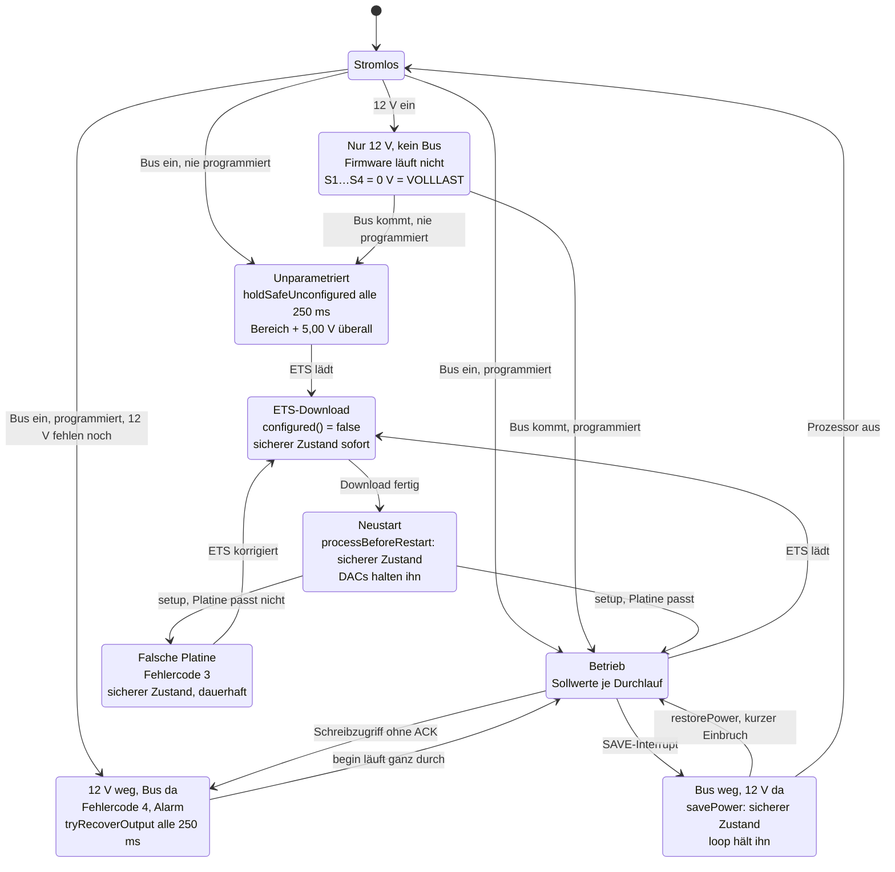

**Zeitfenster mit 0 V**, die bleiben:

| Wann | Dauer | Warum nicht kürzer |
|---|---|---|
| 12 V ohne Bus | unbegrenzt | Ohne Bus läuft keine Firmware. Abhilfe nur in der Installation: 12 V mit dem Bus schalten. |
| 12 V kommen zu laufender Firmware | ≤ Abfrageintervall 250 ms + DAC-Anlauf | Kein EEPROM-Startwert (Invariante 7). |
| Kaltstart mit Bus und 12 V gleichzeitig | Hochlauf bis `setup()` | Messung P16 im Messprotokoll. |

Alle übrigen Übergänge enden in 5,00 V bipolar bzw. 0 V unipolar, bevor der
Zustand wechselt.

---

## 3. Start — `KwlFanModule::setup()`

Reihenfolge nach Invariante 3: **Bereich → sicherer Zustand → Sollwerte**. Das
Raummodul ist als Modul 1 vor dem Lüftermodul (Modul 2) angemeldet, sein `setup()`
ist also schon gelaufen.

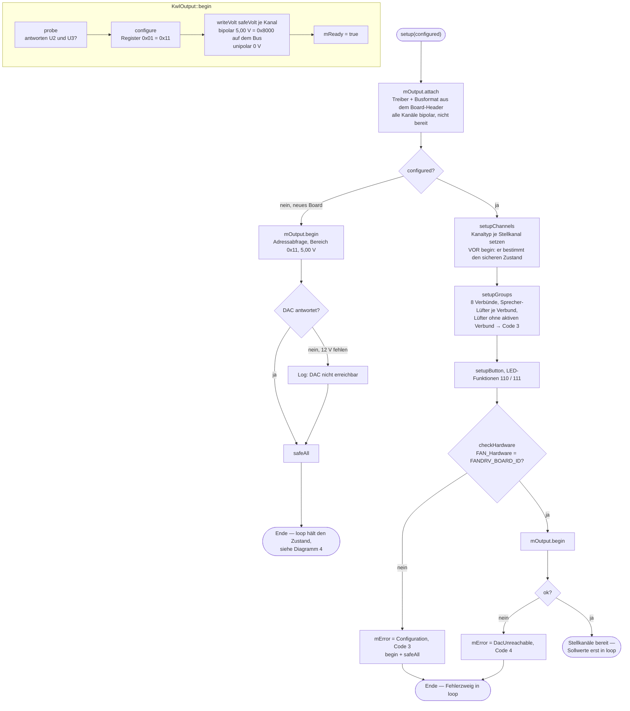

---

## 4. Hauptschleife — `KwlFanModule::loop()`

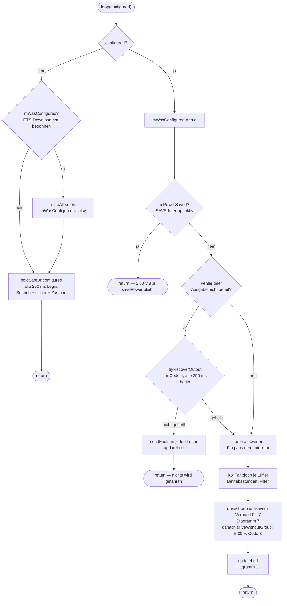

`knx.configured()` ist false, sobald die ETS irgendeine Tabelle lädt, auch nur die
Gruppenadressen, und bleibt es bis zum Neustart (`BauSystemBDevice::configured`).

---

## 5. Raumschleife — `KwlRoom::loop()`

Der Raum treibt nichts. Er liefert Stufe, Herkunft, Richtungsforderung, Deckel und
Zykluswunsch; das Lüftermodul liest sie im selben Durchlauf.

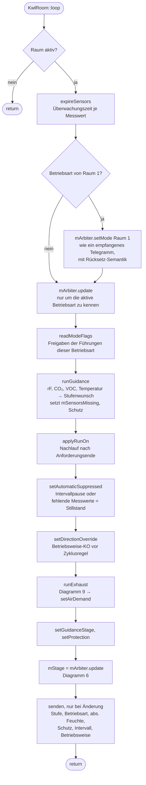

Die Sperre kommt nicht aus dieser Schleife, sondern direkt aus `processInputKo`:
`mArbiter.setLock(active, keepBase)`. Es gibt keinen zweiten Rang-1-Pfad.

---

## 6. Vorfahrt — `StageArbiter::update()`

Zwei Stufen: erst **welche Betriebsart** (Rang 7…11), dann **welche Stufe**
(Rang 1…6). Die Betriebsart liefert Grundstufe und Maximalstufe für Rang 6.

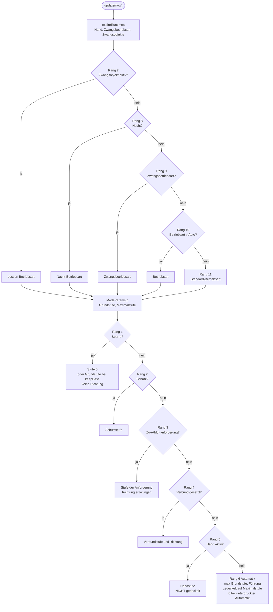

Die Betriebsweise-Vorgabe (Richtung ohne Stufe) wird vor Rang 1 eingetragen und
gilt für alles ab Rang 4 abwärts. Sperre löscht sie, Rang 3 überschreibt sie.

**Rang 4 im Arbiter ist derzeit ungenutzt.** `setGroupStage()` ruft die Firmware
nirgends auf. Der Slave-Verbund läuft stattdessen im Lüftermodul: `collectMembers()`
legt die empfangene Stufe und Halbwelle als einziges Mitglied in den Verbund
(Diagramm 7). Wirkung auf die Rangfolge: Sperre, Schutz und Zu-/Abluftanforderung
des Raums gelten am Slave trotzdem, je Lüfter über `fanStageInGroup()`. Handstufe
und Automatik des Raums haben am Slave keine Wirkung, weil der Raum nicht Mitglied
des Verbunds ist.

**Rücksetz-Semantik** (`resetAbove`): eine Aktion auf Rang *n* ≥ 5 setzt alle
Ränge über *n* bis einschließlich 5 zurück. Rang 1…4 setzt nichts zurück.

| Aktion auf Rang | setzt zurück |
|---|---|
| 11 Standard, 10 Betriebsart | Zwangsbetriebsart, Nacht, Zwangsobjekte, Hand |
| 9 Zwangsbetriebsart | Nacht, Zwangsobjekte, Hand |
| 8 Nacht | Zwangsobjekte, Hand |
| 7, 6 | Hand |

---

## 7. Verbund je Takt-Platz — `KwlFanModule::driveGroup()`

Platz 0…7 sind die ETS-Verbünde 1…8. Jeder Lüfter gehört zu genau einem, auch
ein Lüfter allein im Raum (seit 2026-10-10; davor gab es Platz 8…19 für
„eigenständig“). `inSlot()` entscheidet, welcher Lüfter zu welchem Platz gehört.
Ein Lüfter ohne aktiven Verbund fährt nicht: `driveWithoutGroup()` hält ihn auf
5,00 V und meldet Fehlercode 3.

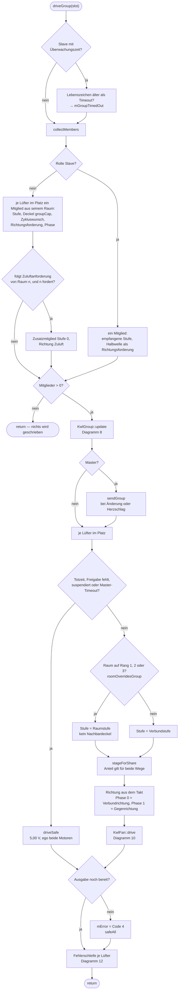

**Stufenregeln** (`KwlGroup::computeStage`):

| Regel | Verbundstufe |
|---|---|
| Maximum mit Deckel (Vorgabe) | höchste Mitgliedsstufe, begrenzt durch den kleinsten Deckel |
| Minimum | kleinste Mitgliedsstufe |
| Raum *n* führt | Stufe des führenden Raums; fehlt er im Verbund: Minimum |

Deckel eines Raums = Maximalstufe seiner Betriebsart, nie unter seiner eigenen
Stufe (`groupCapFor`, Variante a). Ein gesperrter Raum bringt seinen Deckel
weiterhin ein.

**Zykluszeit:** kürzester Wunsch gewinnt (Vorgabe) oder der führende Raum
entscheidet. WRG ist aktiv, wenn gependelt wird und nicht der Sommerzyklus gewählt
ist.

**Richtungskonflikt:** Mehrere Mitglieder fordern eine Richtung. Es führt die höhere
Stufe, bei Gleichstand die kleinere Raumnummer. Der kleinste unterlegene Raum meldet
Code 11.

---

## 8. Takt, Rampe und Totzeit — `KwlGroup::update()`

`mCurrent` ist die Richtung von Phase 0. Die Totzeit ist der einzige Weg von einer
Richtung in die andere (Invariante 5). Seit 2026-10-10 liegt davor und danach je
eine Rampe (`GroupResult::ramp`, 0…1 des Ausschlags um 5,00 V); Rampenzeit 0
überspringt beide Rampen.

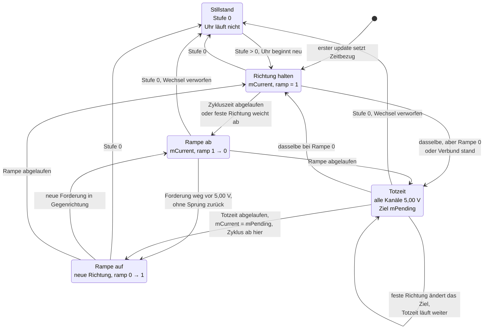

Aus dem Stillstand heraus beginnt der Takt mit der zuletzt gültigen Richtung.
Verlangt eine Forderung dann die andere Richtung, geht es ohne Rampe ab direkt in
die Totzeit – es dreht sich ja noch nichts – und danach die Rampe hinauf.

`KwlFan::drive()` skaliert den Ausschlag um 5,00 V erst nach Kompensation und
Kalibrierung. So bleibt jeder Rampenwert auf der Seite seines Ziels, und der
Totzeitwächter je Kanal sieht keinen zusätzlichen Seitenwechsel. Der Status
„Ausgangsspannung“ meldet das Ziel ohne Rampe.

---

## 9. Abluftanforderung — `KwlRoom::runExhaust()`

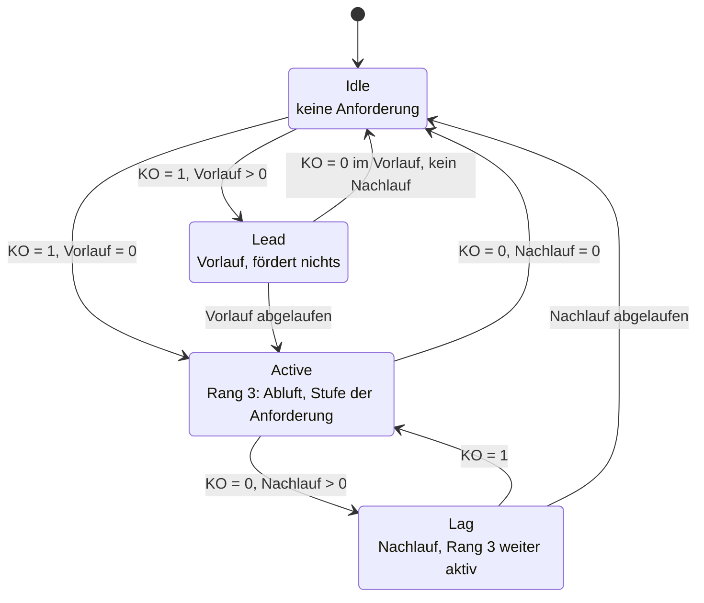

- **Intermittierend:** in Active und Lag nur die Aktivzeit je Periode. In der Pause
  gilt die Automatik des Raums, nicht Stufe 0.
- **Zuluftanforderung:** `mSupplyReq = fördert und „Zuluftanforderung senden“ = Ja`.
  Derselbe Parameter schaltet auch den in-process-Wunsch ab, den Verbünde mit
  „folgt Zuluftanforderung von Raum n“ lesen.
- **Im Verbund** fährt der Lüfter des anfordernden Raums die Stufe der Anforderung,
  ohne Deckel des Nachbarn (Diagramm 7). Die Richtung Abluft geht als
  Richtungsforderung in den Verbund, der Partner mit Phase 1 fährt damit Zuluft.

---

## 10. Vom Stufenwunsch zum Bus — `KwlFan::drive()`

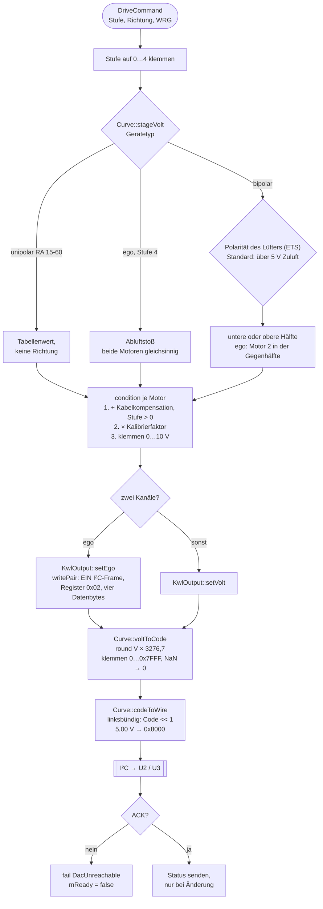

Der sichere Zustand (`driveSafe`, `safeAll`) geht ohne Kalibrierung und ohne
Kabelkompensation direkt auf `safeVolt`: bipolar 5,00 V, unipolar 0 V.

Die Ausgabe schreibt in **jedem** Durchlauf, sie speichert keinen „letzten Wert“
zwischen. Deshalb überschreibt `loop()` einen sicheren Zustand sofort wieder,
wenn es nicht ausdrücklich angehalten wird: `mPowerSaved`, Fehlerzweig,
unkonfiguriert.

---

## 11. Master und Slave

Zwei Geräte teilen einen Verbund. Die Verbund-Objekte hängen am Lüfter mit der
kleinsten Kanalnummer im Verbund.

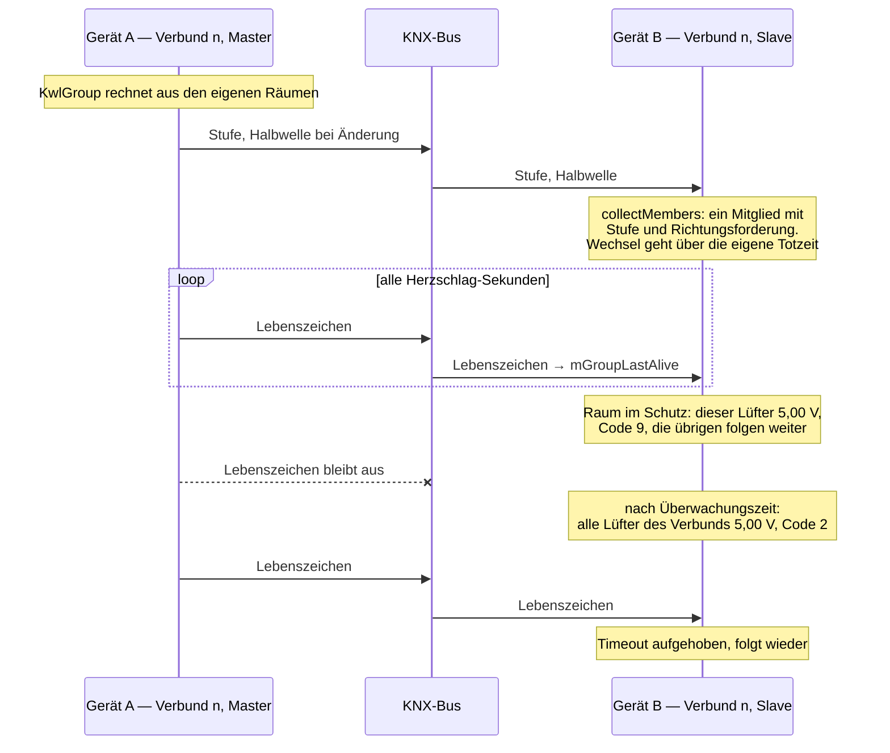

---

## 12. Fehlercode und LED

Je Lüfter gewinnt der **kleinste** anliegende Code (`lowestError`). Codes 1…5 sind
Alarme: Störungs-KO = 1 und Blinkcode an der LED.

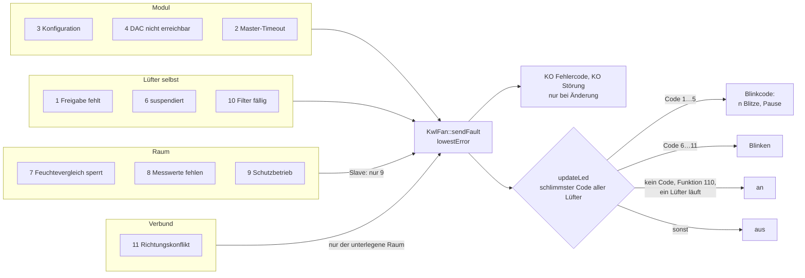

Code 4 heilt von selbst, sobald `begin()` wieder ganz durchläuft (Diagramm 4).
Code 3 heilt nur durch eine korrigierte Parametrierung.
